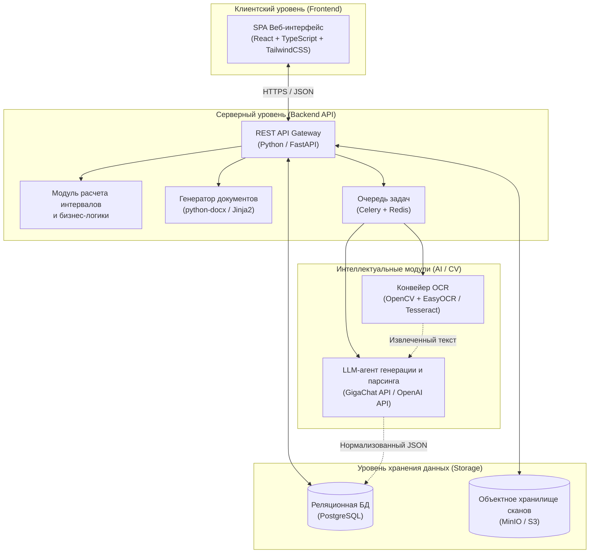

<div align="center">

#  АИС «ДонорРХТУ» (DonorFlow AIS)
### Разработка автоматизированной информационной системы учета доноров университета и документооборота донорского движения
*(на примере Донорского движения РХТУ им. Д.И. Менделеева и ФГБУ «НМИЦ ДГОИ им. Дмитрия Рогачева» Минздрава России)*

[](https://www.python.org/)
[](https://fastapi.tiangolo.com/)
[](https://react.dev/)
[](https://www.postgresql.org/)
[](https://www.docker.com/)
[](https://github.com/JaidedAI/EasyOCR)
[](LICENSE)

</div>

---

##  О проекте (Overview)

Данный репозиторий содержит программную реализацию выпускной квалификационной работы (дипломного проекта) по направлению подготовки **«Программная инженерия» / «Прикладная информатика»**.

**Актуальность проблематики:** Координаторы университетских волонтерских объединений сталкиваются с высокой рутинной нагрузкой. В процессе донорских акций десятки часов уходят на ручную оцифровку бумажных медицинских справок (форма № 447/у), ручной подсчет медицинских отводов, выявление дубликатов, верстку официальных служебных записок (СЗ) на поощрение студентов и подготовку регламентированных паспортов мероприятий для федеральной платформы «Добро.рф».

**Цель проекта:** Создание единой автоматизированной информационной системы (АИС), интегрирующей методы компьютерного зрения (OCR), алгоритмы проверки нормативных ограничений Минздрава РФ, большие языковые модели (LLM) и автоматическую кодогенерацию для комплексной цифровизации бизнес-процессов студенческого донорского движения.

---

## Ключевые возможности (Features)

### 1. Интеллектуальная обработка и антифрод
* **Конвейер OCR (Computer Vision):** Загрузка сканов/фото справок. Автоматическое извлечение *ФИО, даты, типа донации (кровь/тромбоциты) и наименования ОПК* с помощью OpenCV и LLM-нормализации.
* **Автоматический матчинг с БД:** Сопоставление распознанного ФИО с базой контингента обучающихся для определения академической группы студента.
* **Антифрод и дедупликация:** проверка связки `[ФИО + Дата донации]`. Система блокирует повторную загрузку одной и той же справки.
* **Биллинг СЗ (Защита от двойного поощрения):** Флаг `is_rewarded` автоматически присваивается записи после включения студента в подписанную служебную записку, исключая дублирование в будущих приказах.

### 2. Управление контингентом и пре-скрининг
* **«Донорский светофор» и фильтр фенотипов:** Хранение группы крови, резус-фактора и Kell-статуса. Экстренный поиск доступных доноров (например, `O(I) Rh-, Kell-`) для адресных запросов из медицинского центра с учетом их текущего медотвода.
* **Автоматизированный модуль «1 Сентября»:** Регулярное выражение (Regex) автоматически инкрементирует курс в шифрах групп студентов (например, перевод `Кс-33` в `Кс-43`), а 4-й курс переводит в архивный статус «Выпускник», избавляя от ручной актуализации базы.
* **Пре-скрининг и списки на КПП:** Автоматическая генерация списков группы на режимный объект (ОПК) с проверкой отсутствия медотвода на дату выезда.

### 3. Автоматизация документооборота
* **Генератор служебных записок (СЗ):** Формирование официальных документов (`.docx` / `.pdf`) с группировкой студентов по датам, акциям и ролям (доноры цельной крови, доноры компонентов, координаторы) с подстановкой нормативных формулировок.
* **ИИ-ассистент для «Добро.рф»:** LLM генерирует готовое описание мероприятия по кратким вводным. Встроенный валидатор строго соблюдает лимиты платформы (300–3000 символов, смена волонтера ≤ 8 часов).

### 4. Геймификация и аналитика
* **Калькулятор «Путь к Почетному донору»:** Двойной прогресс-бар в личном профиле, отслеживающий накопление донаций для получения знаков «Почетный донор Москвы» и «Почетный донор России» (учет сложных формул смешивания кроводач и плазмафереза).
* **Сводные выписки для ПГАС:** Генерация индивидуальной справки-портфолио (PDF) для подачи студентом заявления на повышенную государственную академическую стипендию.

---

## Бизнес-логика: Калькулятор медицинских интервалов

Ядро системы — алгоритм расчета даты следующего допуска к донации на основе **Приказа Минздрава РФ № 1166н**. Система автоматически учитывает гендерные годовые лимиты (максимум **5 кроводач/год** для мужчин, **4 кроводачи/год** для женщин).

| Предыдущая донация \ Следующая донация | Цельная кровь | Плазмаферез | Тромбоцитаферез |
|:---------------------------------------|:---------------:|:-------------:|:-----------------:|
| **Цельная кровь**                      |   **60 дней**   |    30 дней    |      30 дней      |
| **Плазмаферез**                        |     14 дней     |  **14 дней**  |      14 дней      |
| **Тромбоцитаферез**                  |     14 дней     |    14 дней    |    **14 дней**    |

---

## Архитектура системы (System Architecture)

Система базируется на микросервисно-ориентированной архитектуре с асинхронной обработкой ресурсоемких задач (парсинг изображений и обращение к LLM).



## API и Конвейер данных (Data Pipeline)

### Спецификация основных эндпоинтов REST API

#### 1. Аутентификация и контингент (Auth & Donors)
| Метод | Эндпоинт | Описание функционала |
| :---: | :--- | :--- |
| `POST` | `/api/v1/auth/login` | Аутентификация координатора / сотрудника УВРиМП (выдача JWT) |
| `GET` | `/api/v1/donors` | Получение реестра доноров (пагинация, фильтр по группе крови, резусу, Kell и доступности) |
| `POST` | `/api/v1/donors` | Ручное добавление нового студента-донора в базу |
| `PATCH` | `/api/v1/donors/{id}` | **Изменение данных донора** (смена группы, актуализация фенотипа, контактов) |
| `GET` | `/api/v1/donors/{id}/intervals` | Расчет индивидуального календаря допусков и прогресса «Почетного донора» |
| `POST` | `/api/v1/donors/promote-courses` | **Модуль «1 Сентября»:** массовый перевод курсов (+1) по Regex и архивация выпускников |

#### 2. Донации, OCR и Верификация (Donations & CV)
| Метод | Эндпоинт | Описание функционала |
| :---: | :--- | :--- |
| `POST` | `/api/v1/ocr/parse-certificate` | Загрузка скана справки ф. 447/у в MinIO, постановка задачи в Celery (OCR + LLM) |
| `GET` | `/api/v1/ocr/tasks/{task_id}` | Получение результата распознавания и проверка флага антифрода (`is_duplicate`) |
| `PUT` | `/api/v1/donations/{id}/verify` | **Валидация и изменение данных справки** координатором (ручная правка ошибок OCR и сохранение в БД) |
| `DELETE`| `/api/v1/donations/{id}` | Удаление ошибочной или дублирующей записи о донации |

#### 3. Документооборот и ИИ-генерация (DocGen & AI)
| Метод | Эндпоинт | Описание функционала |
| :---: | :--- | :--- |
| `POST` | `/api/v1/documents/memo/generate` | Генерация служебной записки (`.docx`) за период и установка флага `is_rewarded = True` |
| `POST` | `/api/v1/documents/kpp-list` | Генерация списков на проходную (КПП) ОПК с автоматическим отсевом студентов с медотводом |
| `GET` | `/api/v1/documents/pgas/{donor_id}` | Выгрузка портфолио донора (`.pdf`) для подачи на повышенную стипендию (ПГАС) |
| `POST` | `/api/v1/ai/dobro-rf/generate` | Генерация и валидация паспорта мероприятия для платформы «Добро.рф» через LLM |

### Пример JSON-ответа от модуля распознавания (OCR + LLM)
```json
{
  "status": "success",
  "confidence_score": 0.96,
  "is_duplicate": false,
  "extracted_data": {
    "student_id": "4810291b-8d5c-4e1a-9c12-0a2b3c4d5e6f",
    "full_name": "Князева Милана Игоревна",
    "academic_group": "Э-14",
    "donation_date": "2026-10-07",
    "donation_type_ru": "Тромбоциты",
    "medical_center_short": "НМИЦ Рогачёва",
    "donation_sequence_number": 2
  },
  "medical_intervals": {
    "next_whole_blood_allowed": "2026-10-21",
    "status_comment": "Донор доступен для записи с 21.10.2026. Медотвод: 14 дней."
  }
}
```

---

## Информационная безопасность и ФЗ-152

Поскольку система обрабатывает персональные данные (ПДн) и сведения о фактах донации (**ФЗ № 152-ФЗ** и **ст. 13 ФЗ № 323-ФЗ**), в проекте реализованы жесткие меры защиты:
1. **Минимизация данных:** Не хранятся диагнозы и результаты анализов. Фиксируется исключительно факт донации (справка ф. 447/у).
2. **Изоляция хранилища (MinIO):** Оригиналы справок хранятся в защищенном бакете. Доступ предоставляется только через временно подписанные ссылки (Presigned URLs) со сроком жизни 15 минут.
3. **Обезличивание:** Перед отправкой неструктурированного OCR-текста в облачную LLM, локальный препроцессор маскирует потенциальные паспортные данные, телефоны и СНИЛС регулярными выражениями.
4. **Ролевая модель (RBAC):** Доступ к документам закрыт JWT-аутентификацией только для координаторов и сотрудников УВРиМП.

---

## Стек технологий (Tech Stack)

| Категория | Технологии и библиотеки | Назначение в проекте |
| :--- | :--- | :--- |
| **Backend** | Python 3.11, FastAPI, SQLAlchemy 2.0, Pydantic | Разработка REST API, валидация данных, ORM |
| **Frontend** | React 18, TypeScript, TailwindCSS, Shadcn/UI | Клиентское SPA-приложение, интерактивные дашборды |
| **База данных** | PostgreSQL 16, Redis 7, Celery, MinIO | Хранение данных, фоновые очереди задач, объектное S3-хранилище |
| **CV & AI** | OpenCV, EasyOCR, LangChain, GigaChat / OpenAI API | Предобработка фото, распознавание кириллицы, NER-парсинг текста |
| **Документы** | `python-docx`, `docxtpl` (Jinja2), WeasyPrint | Шаблонизация и экспорт СЗ / выписок в DOCX и PDF |
| **DevOps** | Docker, Docker Compose, Nginx, Pytest | Контейнеризация, проксирование, автоматическое тестирование |

---

## Примеры сформированных документов

> Ниже представлены реальные артефакты, сгенерированные системой `DocGen` и `LLM Agent`.

### 1. Служебная записка на поощрение обучающихся (Фрагмент)
*Сгенерировано в формате `.docx` по стандартам делопроизводства РХТУ.*
```text
Уважаемая Лина Александровна!
1. Просим Вас объявить благодарность за помощь в проведении мероприятия «Донорская акция 06.07.2026 – 22.07.2026 года в НМИЦ ДГОИ имени Дмитрия Рогачева (Федеральный центр)» 06.07.2026 – 22.07.2026 года...

| № | ФИО | Группа | Обоснование |
| 1 | Годьяк Тимур Романович | Тм-16 | Осуществление донации цельной крови в добровольном порядке |
| 4 | Кузнецов Владислав Валерьевич | Кс-33 | Осуществление донации тромбоцитов в добровольном порядке |

2. Просим Вас объявить благодарность за организацию и проведение мероприятия...
| № | ФИО | Группа | Обоснование |
| 1 | Кузнецов Владислав Валерьевич | Кс-33 | Координация и сопровождение группы доноров на всех этапах |
```

### 2. Паспорт мероприятия для «Добро.рф» (ИИ-генерация)
*Строго соблюден лимит 300–3000 символов и ограничение рабочих смен.*

| Поле формы заявки | Сгенерированное системой значение |
| :--- | :--- |
| **Название** | Выездная донорская акция студентов РХТУ в ФГБУ «НМИЦ ДГОИ им. Дмитрия Рогачева» |
| **Описание** *(842 симв.)* | Мероприятие направлено на развитие безвозмездного регулярного донорства крови...<br>**Цели и задачи:**<br>1. Организация безопасного выезда группы.<br>2. Популяризация кадрового донорства.<br>**Требуемая помощь:**<br>Волонтеры осуществляют сбор участников, контроль диеты донора, помощь в заполнении медицинских анкет. |
| **Время проведения** | 08:30 – 13:30 *(Общая продолжительность: 5 часов. Соответствует норме ≤ 8 ч.)* |
| **Вакансии** | 1. Координатор сопровождения — 1 чел.<br>2. Волонтер-информатор — 1 чел.<br>3. Волонтер-донор — 15 чел. |

---

## Научно-практическая значимость (Thesis Value)

Внедрение разработанной АИС обладает высокой ценностью для инфраструктуры вуза:
1. **Исключение человеческого фактора и антифрод:** Автоматизация расчетов полностью устраняет риск направления на выездную акцию студента с действующим медицинским отводом, а механизм дедупликации исключает ошибочные двойные поощрения по одной и той же справке.
2. **Оптимизация трудозатрат до 90%:** Время на оцифровку одной справки сокращено с 3 минут ручного ввода до 4 секунд машинного времени. Подготовка сводной семестровой служебной записки на 200+ человек сокращена с нескольких рабочих дней до 10 секунд.
3. **Масштабируемость решения:** Архитектура не привязана жестко к специфике РХТУ. Контейнеризованный комплекс может быть развернут "из коробки" (On-Premise) в любом университете РФ, развивающем корпоративное донорство и сотрудничающем со Службой крови.

---
